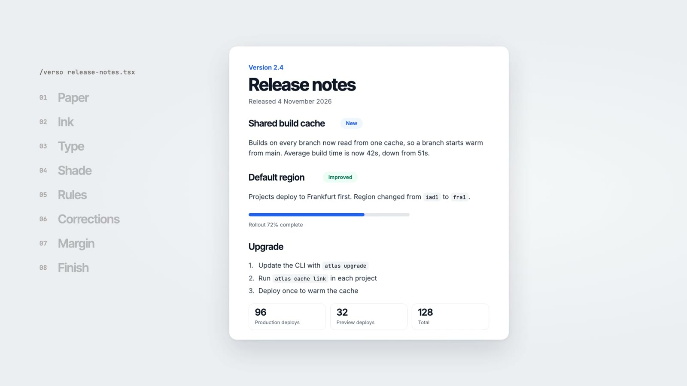
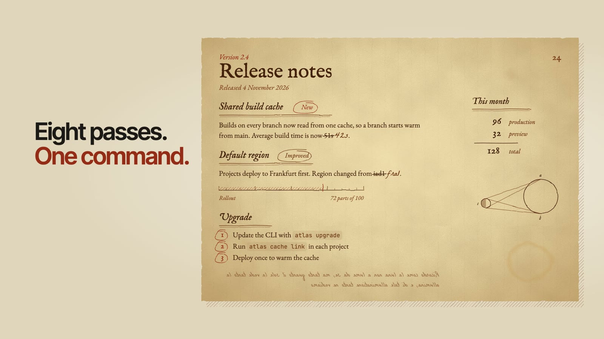
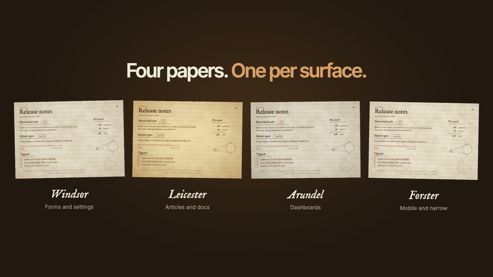
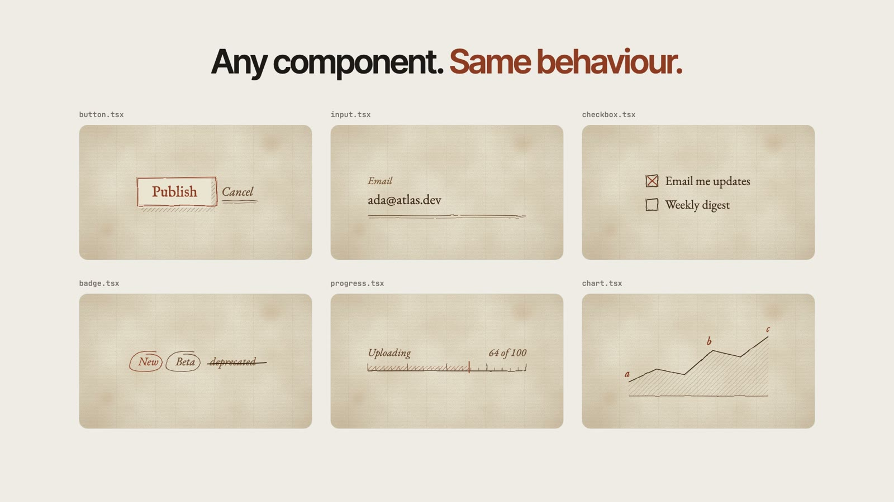

# verso

A Claude Code skill that redraws any part of your UI as a page from Leonardo da Vinci's notebooks. The page gets laid rag paper, iron gall ink faded to browns, hatching in place of shadows, hand rules, margin notes and pen sketches.

You point it at one component. The skill changes how that component looks. The DOM, the event handlers and the focus order stay the same.





## Install

```
npx skills add sanyampunia/verso
```

The command copies the skill into `.agents/skills/verso` and links it into `.claude/skills`.

## Use

```
/verso <component>
```

Name a file, a component, a route or a selector. For example:

```
/verso the settings card
/verso app/blog/page.tsx in the forster style
```

The skill converts only the portion you name. The rest of the app does not change.

## What it does

1. Reads your project first. It writes the theme in the styling you already use, such as Tailwind, CSS modules or plain CSS, and follows the rules in your `CLAUDE.md` or `AGENTS.md`.
2. Picks a paper for the surface.
3. Converts the portion part by part: the paper, the ink, the type, the shading, the rules, the fields, the badges, the charts and the progress bars.
4. Composes it as a working page, with a margin, one pen sketch and a little decorative mirror script.
5. Checks the result at desktop and phone width, in a browser when one is available.

## Four papers



| Paper | Use it for |
|---|---|
| Windsor | Forms, settings and dense panels. This is the default. |
| Leicester | Articles, docs, release notes, heroes and empty states. |
| Arundel | Dashboards and boards of many small parts. |
| Forster | Narrow cards, sidebars, lists and mobile screens. |

To use a specific paper, name it in the request.

## Any component



| Part | Becomes |
|---|---|
| Card | Space and a hand rule, or a loose pen frame |
| Shadow | Pen hatching |
| Badge | A circled word |
| Input | A ruled line |
| Checkbox | An ink square with a cross |
| Progress bar | A ruled scale with finer divisions at the ends |
| Chart | A pen line, hatched fill and lettered points |
| Changed value | The old value struck through, the new one in the hand |

## Guardrails

- Body text is 10.3:1 contrast or better on every paper. Every line of real text clears 4.5:1.
- Mirror script is decoration only. It carries `aria-hidden` and never holds real content.
- Elements, roles, labels, states and handlers stay as they were.
- Focus is always visible.
- The theme respects `prefers-reduced-motion`.

## Files

```
skills/verso/
  SKILL.md               the workflow the agent follows
  references/style.md    the research, the palette and the mapping table
  assets/manuscript.css  the theme, scoped under .ms-scope
  assets/defs.svg        four SVG filters for ink, line, deckle and wash
  assets/sketches.svg    pen sketches to place on a page
  examples/              two worked conversions, before and after
```

To see the examples, serve the skill folder and open `examples/index.html`:

```
cd skills/verso && python3 -m http.server 4400
```
